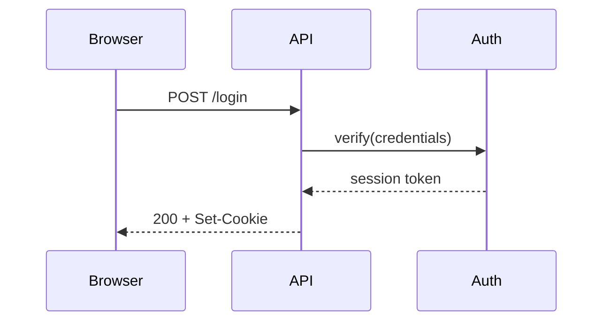
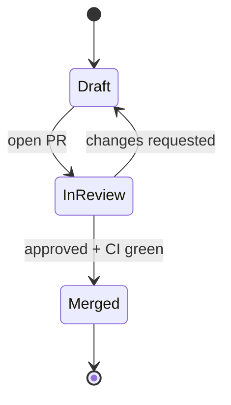
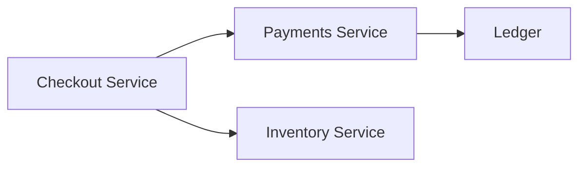

Every developer vault eventually grows a folder of screenshots: a whiteboard photo from a planning meeting, an exported PNG of a sequence diagram, a draw.io file nobody can open on their phone. They rot fast. The code changes, the picture doesn't, and six months later you're squinting at boxes that describe a system that no longer exists.

Obsidian has a better option built in, and a lot of people never notice it. Any code block tagged `mermaid` renders as a live diagram, no plugin required. The diagram is just text in your note, so it searches, syncs, diffs in git, and edits in two seconds when the architecture shifts.

## Your first diagram is a code block

Open any note and add a fenced block with the `mermaid` language tag. Switch to Live Preview or Reading view and it renders in place:

````markdown

````

That's the whole setup. Mermaid covers the diagrams developers actually draw: flowcharts (`graph TD` or `flowchart LR`), sequence diagrams, class diagrams, state diagrams (`stateDiagram-v2`), entity relationship diagrams, and Gantt charts. If you're unsure of the syntax, draft in the [Mermaid Live Editor](https://mermaid.live) and paste the result into your note.

A state machine is a good example of something that is painful to describe in prose and trivial to read as a picture:

````markdown

````

Put that at the top of the note documenting your release process and nobody has to read three paragraphs to understand the flow.

## Turn nodes into links to your notes

This is the part that makes Mermaid feel native to Obsidian instead of bolted on. Per the [Obsidian help docs](https://obsidian.md/help/advanced-syntax), you can make flowchart nodes clickable internal links by attaching the `internal-link` class:

````markdown

````

Each node now opens the note whose name matches its label. So if you keep one note per service, the diagram becomes a clickable map of your system: click "Payments Service" and you land on its runbook, its endpoints, its on-call notes.

A few details worth knowing:

- The link target is the node text, so name the nodes exactly like your notes.
- Note names with special characters need double quotes, such as `A["Auth (legacy)"]`.
- The docs suggest a lazy trick for big diagrams: label nodes with letters and apply the class to `A,B,C,...,Z` in one line, so every node you define is linked.
- Links inside diagrams **do not show up in Graph view** or count as backlinks. If a relationship matters for navigation, also write a normal `[[wikilink]]` somewhere in the note body.

That last point is the main tradeoff. The diagram is a great way to read connections, but Obsidian doesn't index them, so don't let a diagram become the only place a link exists.

## Where it falls short

Obsidian ships its own bundled copy of Mermaid, and it has historically trailed the upstream release. The [Obsidian forum](https://forum.obsidian.md/t/recurrent-upgrade-mermaid-js-to-the-latest-version-x-y-z/65374) has a long-running thread asking for upgrades, and users regularly report newer diagram types failing with a "No diagram type detected" error. If an example from the Mermaid docs breaks in your vault but works in the Live Editor, the bundled version is the likely cause, not your syntax. Stick to the established types (flowchart, sequence, class, state, ER, Gantt) for anything you rely on. If you truly need the newest features, community plugins exist that load a current Mermaid build, but that's one more plugin to trust and maintain.

Layout is the other limit. Mermaid decides where boxes go, and past about 15 to 20 nodes the auto-layout gets tangled. When that happens, split the diagram: one high-level overview that links to a note per subsystem, each with its own small diagram. That structure is easier to maintain anyway. And if what you want is freeform spatial arranging rather than a structured diagram, Canvas or Excalidraw is the better tool.

Styling is possible but fiddly. Mermaid supports per-diagram config through an init directive on the first line, for example `%%{init: {"theme": "neutral"}}%%`, and `classDef` for node colors. Keep it light. Diagrams that lean on the default theme follow your Obsidian light and dark mode, while heavy custom colors often look wrong in one of them.

## Make it a habit

The best place to start is wherever you already have a stale image. Pick one screenshot of a flow or an architecture sketch in your vault, rewrite it as a Mermaid block, and link the nodes to the notes they describe. Once the diagram lives in the same text file as the explanation, updating it becomes part of updating the note, which is the only way documentation diagrams ever stay accurate. The [Mermaid syntax docs](https://mermaid.js.org/intro/) and Obsidian's [advanced formatting page](https://obsidian.md/help/advanced-syntax) cover everything else you'll need.
